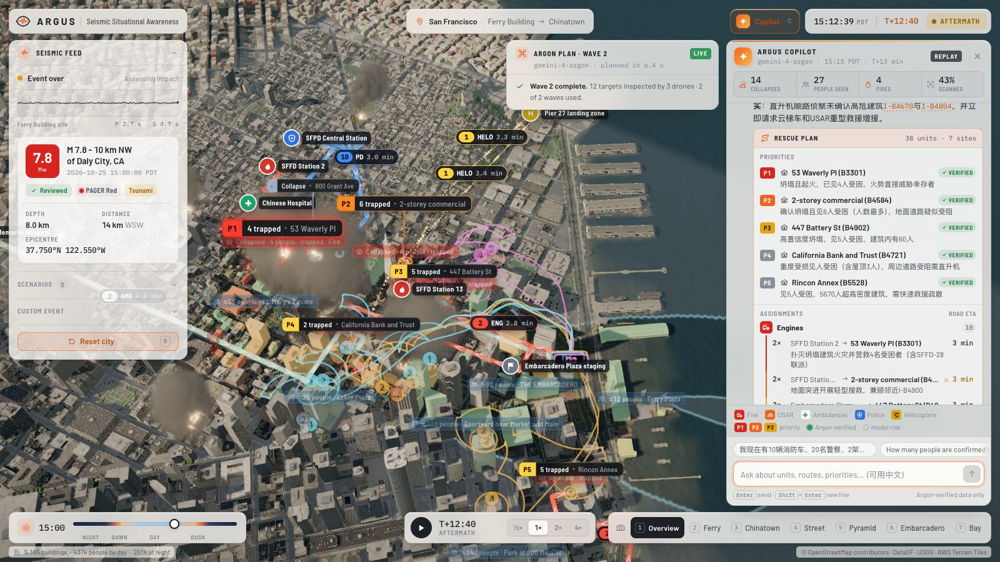
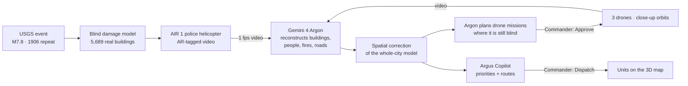
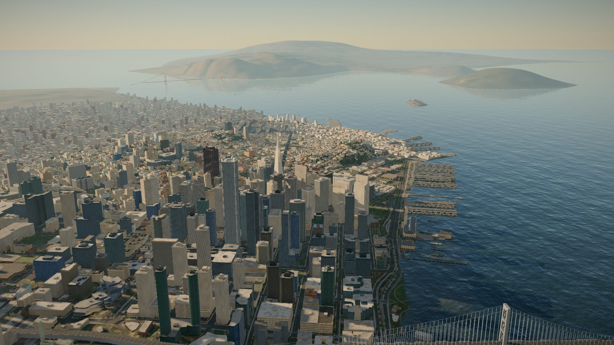
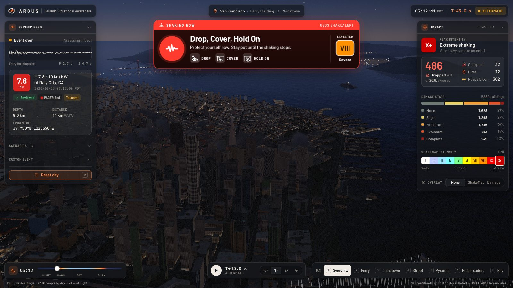
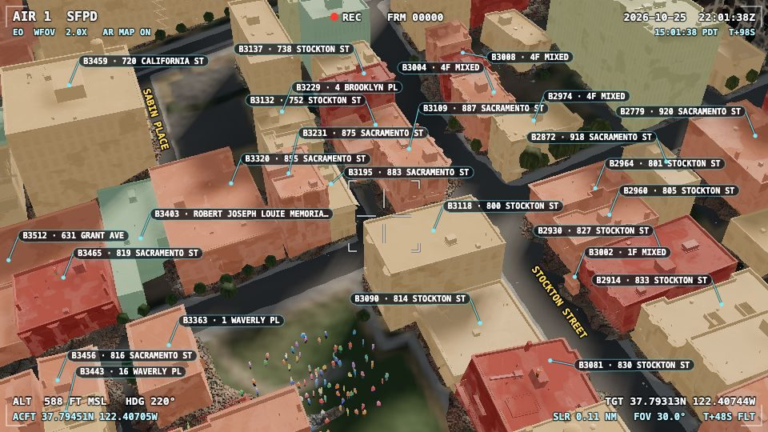
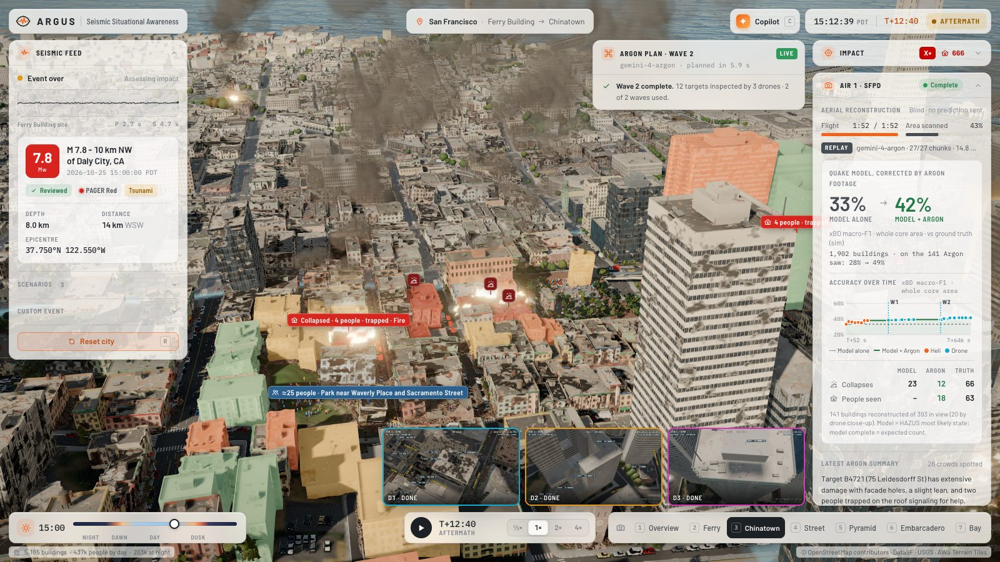
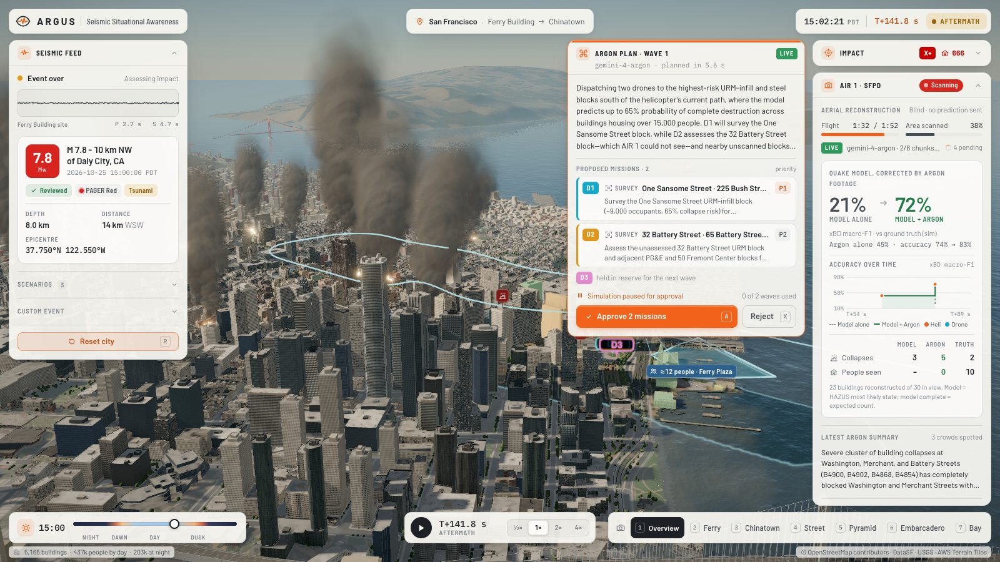
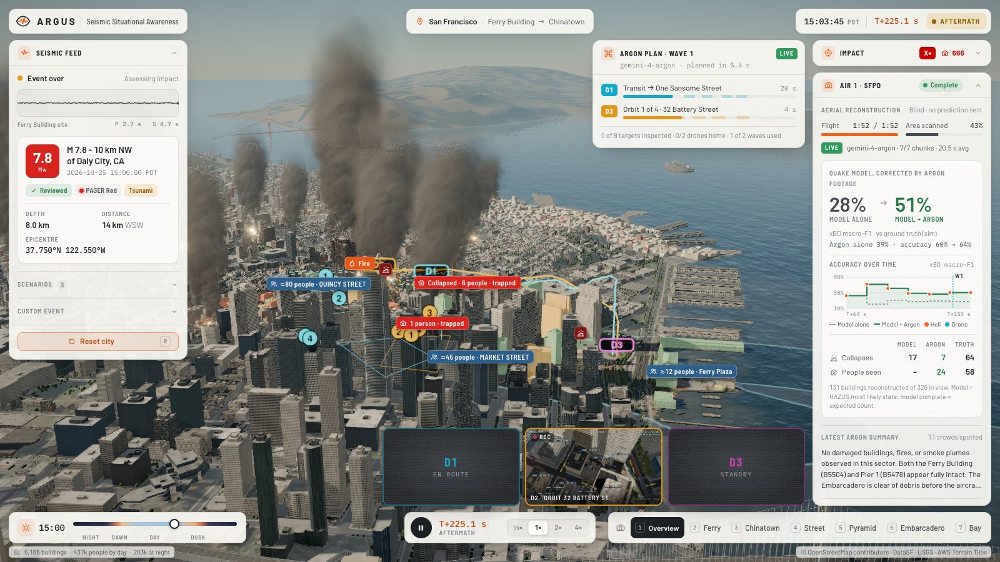
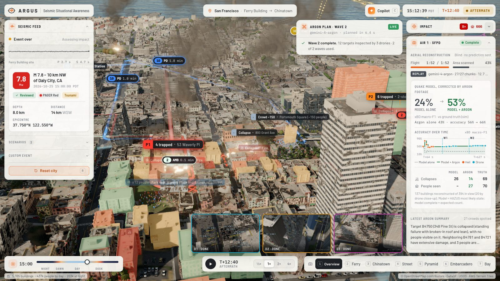

<div align="center">

# ARGUS

### The hundred-eyed watcher for the first hour after an earthquake

**Gemini 4 Argon watches the city, corrects the disaster model, and tells rescuers where the trapped are.**




*Gemini 4 Argon Hackathon · San Francisco · Track 2: More Dimensions*

</div>

---

## The problem

In 1976, the Tangshan earthquake killed more than 240,000 people. Many survived the collapse itself and died waiting under the rubble, because rescuers did not know where to look. The author's family was among those trapped.

Fifty years later, the first hour after a major quake is still a fog:

- **Models are blind.** Damage estimates such as USGS PAGER and FEMA Hazus are produced in minutes, but they are statistics: they cannot tell which building on a block fell and which one stood.
- **Cameras are everywhere, but nobody can watch them all.** Police helicopters and drones stream hours of footage, and an operations centre cannot review it frame by frame.
- **Commanders need decisions, not dashboards.** *I have 10 engines, 20 officers and 2 helicopters. Where do they go first, and by which streets?*

## What Argus does

Argus closes the loop between **prediction → observation → correction → action**, with Gemini 4 Argon at every step and a human commander approving every move.



## Features

### 1. A real-data digital twin of San Francisco
From the Ferry Building to Chinatown, built from open data rather than generated:

- **5,689 buildings** from OpenStreetMap. Heights come from OSM tags (3,565 buildings) and **DataSF LiDAR** (1,550). Year built (4,784 buildings) and construction type come from the **San Francisco Assessor**, and soft-story buildings are flagged from the city's retrofit registry.
- **3,730 streets**, **7,777 street trees** (DataSF), real terrain and bay bathymetry (AWS Terrain Tiles / USGS 3DEP), and the historic 1849 shoreline (bay fill is where liquefaction strikes).
- Hand-modelled landmarks: the Ferry Building clock tower, the Transamerica Pyramid, the Chinatown Dragon Gate and Grant Avenue lanterns, the Bay Bridge with the Bay Lights, Coit Tower, Old St. Mary's and the Sentinel Building.
- A physically based sky computed for San Francisco on the hackathon date, image-based lighting, ambient occlusion, bay water, and a horizon of real islands and hills.



### 2. A physics-grounded earthquake
- **USGS GeoJSON events** and a **ShakeAlert**-style warning. Three scenarios are included: the 1906 San Andreas M7.8 repeat, the Hayward M7.0 (USGS HayWired) and the Loma Prieta M6.9 repeat.
- Finite-fault distances, a published California ground-motion model with a Vs30 site term and spatially correlated residuals, the Worden et al. (2012) intensity conversion, **HAZUS fragility curves** by structure type and code era, liquefaction on fill, collapse, debris, fires, casualties and blocked roads.
- On screen: P- and S-wave fronts sweeping the city, buildings swaying at their own periods, collapse with dust and debris, fires, a cascading power outage, and ShakeMap and damage overlays.



### 3. AIR 1: Gemini 4 Argon reads helicopter footage
A police helicopter flies a fixed route over the damage. Its gimbal camera is rendered off-screen with a police-style **AR mapping overlay** (street names and building address tags), encoded as **1 fps video**, and sent to **gemini-4-argon**. Argon reconstructs, **blind** (it never sees the model's prediction):

- the damage class of every tagged building (none, slight, moderate, extensive, collapsed), with confidence and the video second as evidence;
- people visible on rubble and rooftops, and signs that someone is trapped;
- fires, smoke, blocked streets and evacuee crowds.

<table><tr>
<td width="38%"><br/><sub>What Argon sees: the AIR 1 feed with AR tags</sub></td>
<td><br/><sub>Argon's reconstruction on the city; the model is corrected live</sub></td>
</tr></table>

**Correcting the model, not just labelling footage.** Every observation tells Argus how much harder or softer the ground shook at that spot than the median. Ground motion is spatially correlated, so that correction spreads to nearby unobserved buildings, the same idea as a ShakeMap updated with field reports. Assessing **7% of the city** improves the damage picture for **all of it**.

### 4. Argon decides where to look next, and the commander approves
After the helicopter pass, Argon reasons over **uncertainty**, never over truth: unscanned high-risk blocks, low-confidence calls, places where the model and the footage disagree, and people at risk. It proposes drone missions with a rationale. **The simulation pauses for the commander's Approve.** Three drones fly low orbits, the close-up video goes back to Argon, and a second wave follows.

<table><tr>
<td><br/><sub>Argon's plan, written in 5.6 s, waiting for Approve</sub></td>
<td><br/><sub>Drones on mission, live camera thumbnails</sub></td>
</tr></table>

### 5. Argus Copilot: ask, plan, route, dispatch
The commander types a question in plain language:

> *"I have 10 fire engines, 20 police officers, 2 helicopters and 6 ambulances. How should I route them, and what are the priorities?"*

Argus packages the live situation: Argon-verified incidents, unverified model risk, verified and likely blocked roads, and real SF facilities (SFFD stations 2, 13, 28 and 35, SFPD Central, Chinese Hospital, Saint Francis Memorial, staging areas and a helicopter landing zone), with ETAs computed on the road network. Gemini 4 Argon returns ranked priorities, unit assignments, route clearing and its assumptions. Argus then draws every route on the 3D city, around blocked streets. **Units move only after Dispatch.**



### 6. Resident reports: the city talks back
Simulated residents post short messages from a community app: *"Someone is trapped inside, we can hear them. My building at 27 Dashiell Hammett St…"*, or simply *"We're OK, just cracks."* The stream is noisy. People describe the building across the street, exaggerate, repeat each other and write in English, Chinese or Spanish. Every 30 seconds Gemini 4 Argon triages a batch: it links each report to a building, reads the damage and the number of trapped people, and rates credibility. The reports pop up as live cards and feed the fusion as a third, lower-weight evidence source. They sharpen the damage picture and leave drone planning and the Copilot unchanged.

## Results

Measured on the recorded live run (1906 repeat, 15:00 local), scored against the simulator's hidden ground truth on the **xBD** aerial damage scale (no damage / minor / major / destroyed):

| xBD macro-F1 | Model alone | Model + Argon |
|---|---:|---:|
| **Whole core area** (1,902 buildings, including the ones nobody saw) | 33% | 38% after AIR 1 → 42% after drone wave 1 → **43%** at the end |
| **Buildings seen on video** (111, scored on the same buildings) | 24% | **46%** |
| Whole core area *without* resident reports | 33% | 39% |

- **Resident reports:** Argon linked 77% of 198 reports to the right building, and read the damage correctly on 96% of those. Resident reports add about 4 points to the whole-area score.
- **The model alone cannot tell intact from destroyed.** It labels nearly everything "major damage". Argon finds the buildings that are fine (no search needed) and the ones that fell (search first).
- **Latency with gemini-4-argon:** ~20 s per 15-second helicopter chunk, ~13 s per drone orbit, ~6 s per drone plan, and 6–26 s per Copilot answer. Every response is recorded and replays offline in milliseconds.

> Honest note: the city, the earthquake and the "truth" are simulated. Truth is used **only to score**; Argon never sees it, and neither does the planner or the Copilot.

## Why Gemini 4 Argon

| Capability | How Argus uses it |
|---|---|
| **Long video understanding** | 15-frame helicopter chunks and drone orbits, read as video with per-second evidence |
| **Multimodal grounding** | Reads the AR overlay (tags, street names, HUD) to tie what it sees to exact building IDs and addresses |
| **1M-token context** | The full situation (incidents, roads, facilities, ETAs) plus conversation history in every Copilot turn |
| **Structured output** | Reconstructions, drone plans and rescue plans come back as schema-validated JSON that drives the 3D world |
| **Frontier reasoning** | Plans under uncertainty, trades distance against value, holds a reserve drone, and states its assumptions |

## Architecture

```
web/
├─ src/
│  ├─ engine/        renderer, physical sky + sun for SF, IBL, AO, bloom, bay water, camera
│  ├─ city/          procedural buildings (facade shader, interior mapping, damage states), streets, landmarks
│  ├─ quake/model/   USGS events, ground motion, HAZUS fragility, blind prediction, roads, ShakeAlert
│  ├─ quake/fx/      waves, shaking, collapse, debris, dust, fire, power outage, overlays
│  ├─ truth/         simulated survivors and crowds (hidden from Argon)
│  ├─ air/           AIR 1 helicopter, scan coverage, off-screen AR frame capture
│  ├─ drones/        3-drone fleet, mission schedules, orbits
│  ├─ argus/         reconstruction layer, fusion, spatial correction, planner candidates
│  ├─ rescue/        road graph router, SF facilities, situation builder, 3D rescue layer
│  ├─ app/           sessions orchestrating helicopter, drones and Copilot
│  └─ ui/            HUD, AIR panel, plan card, drone feeds, Copilot drawer
├─ server/           Vite plugin: /api/reconstruct, /api/plan, /api/chat (+ replay)
├─ scripts/          data pipeline (OSM, DataSF, terrain), e2e test, screenshot harness
└─ data/recon-cache/ recorded gemini-4-argon responses for offline replay
```

**Stack:** TypeScript, Vite, three.js, postprocessing and n8ao, `@google/genai`, ffmpeg, Playwright.

## Run it

```bash
cd web
npm install --legacy-peer-deps
cp .env.example .env          # add your GEMINI_API_KEY (model: gemini-4-argon)
npm run dev                   # http://127.0.0.1:5173 (also serves the Gemini API routes)
```

| Mode | URL |
|---|---|
| **Live** (calls Argon; you click Approve and Dispatch) | `/?cam=overview&tod=15&speed=3`, then **Simulate** the 1906 scenario |
| **Replay** (recorded Argon responses, works offline) | `/?cam=overview&tod=15&quake=san_andreas_1906&speed=3&air=replay` |
| **End state** (all recon done; open Copilot) | `/?cam=overview&tod=15&quake=san_andreas_1906&t=760&air=replay` |

Keyboard: `Space` pause · `R` reset · `1–7` camera presets · `C` Copilot · `A`/`X` approve or reject a plan.
Tests: `node scripts/e2e.mjs` drives the full flow through the UI on a real GPU (headless Chromium).
Data: `scripts/data/` rebuilds `city.json` and the terrain from OSM, DataSF and AWS Terrain Tiles.

## Roadmap: the full Argus

The hackathon build covers aerial intelligence. These are the next sources Argus is designed to fuse. **None of them is implemented yet.**

- **Voice of the city.** Ingest live 911 and non-emergency calls. Argon listens to the call audio natively, extracts location, people and hazards across languages, removes duplicate reports, and cross-checks each call against aerial evidence (*"the caller says 3 trapped; the drone shows 5 at 14 s"*).
- **News, radio and hotline monitoring.** Broadcast and livestream feeds, scanner traffic and public hotlines turned into geolocated incident reports.
- **Social signals.** Geotagged public posts from survivors, beyond the community-app channel.
- **Real feeds.** RTSP streams from police and fire aircraft and drones, CAD (computer-aided dispatch) integration and live unit positions (AVL).
- **Night and thermal.** Thermal cameras for survivors after dark, and aftershock forecasts (USGS OAF) to drive re-inspection.
- **Any city, any quake.** Point Argus at a live USGS event feed and a city's open data.

## Built at the hackathon

Every Gemini 4 Argon capability in Argus was built during the event: AIR 1 video reconstruction, spatial correction of the city model, Argon-planned drone missions with commander approval, resident-report triage, and Argus Copilot with routing and dispatch.

## Credits and data

© OpenStreetMap contributors (ODbL) · DataSF: Building Footprints, Assessor Secured Property Tax Rolls, Soft-Story Properties, Street Tree List · USGS: earthquake event format, ShakeAlert, 1906, HayWired and Loma Prieta scenarios · AWS Terrain Tiles (USGS 3DEP) · FEMA HAZUS-MH fragility methodology · xBD damage scale (Gupta et al., 2019).

Argus is a research prototype for a hackathon. It is not an emergency service. The simulator's numbers are illustrative and not engineering-grade.
